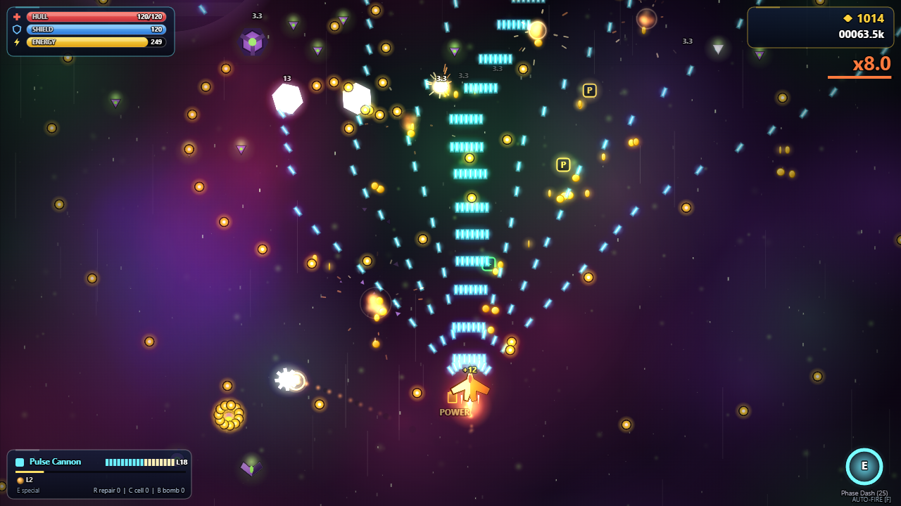

# Riftrunner

A roguelite vertical shoot-'em-up in the spirit of Tyrian, shipped as **one standalone HTML file**. No engine, no libraries, no external assets: every sprite is drawn procedurally on a canvas and every sound is generated with WebAudio.



## Play

**[Play in your browser](https://underscorelog.github.io/riftrunner/)**, or download [`riftrunner.html`](riftrunner.html) and open it locally. Progress (scrap, unlocks, settings) is saved in `localStorage`.

## Features

- **4 sectors** (Asteroid Belt, Derelict Station, Alien Hive, Solar Foundry), each 4-5 stages ending in a multi-phase boss with telegraphed attacks
- **Branching node map** between stages: Combat, Elite, Shop, Repair, Mystery events, Secret levels
- **3 ships** with distinct stats and specials (Pulse Barrier, Phase Dash, Nova Bomb)
- **7 front weapons**, each leveling 1-20 with visibly changing fire patterns
- **4 sidekicks** (Wing Drone, Mini-Turret, Missile Pod, Shield Orb)
- **85 upgrades** across rarity tiers, including synergies and cursed cards
- **23 enemy types** spawned from scripted, seeded wave timelines
- **Energy system**: a generator feeds both weapons and shield recharge; low energy throttles fire rate instead of cutting power
- **Meta progression**: earn scrap to unlock ships, weapons and 17 hangar perks
- **Seeded runs** plus a date-based **Daily Run**
- 4 difficulty levels, gamepad and touch support, adaptive widescreen arena, bloom and particle effects

## Controls

| Action | Keys |
|---|---|
| Move | WASD / arrows / left stick / drag on touch |
| Focus (slow, shows hitbox) | Shift |
| Fire | Auto-fire (toggle F) or Space |
| Special + sidekick burst | E |
| Repair kit / Energy cell / Smart bomb | R / C / B |
| Pause | P or Esc |
| Mute / Fullscreen | M / G |

## Build from source

The game is split into ordered modules in `src/` and concatenated into the single HTML file.

```bash
node build.js            # -> riftrunner.html (full game)
node build.js --slice    # -> riftrunner-slice.html (sector 1 only)
node serve.js            # local server on http://localhost:5311
```

Edit `src/*.js` and rebuild; never hand-edit `riftrunner.html`. Files load in numeric order:

| File | Role |
|---|---|
| `00_util.js` | Math helpers, seeded RNG, constants |
| `10_data.js`, `11_content.js`, `18_content2.js` | Ships, weapons, sidekicks, upgrades, perks, enemies, sectors |
| `15_audio.js`, `16_input.js` | WebAudio music/SFX, keyboard/gamepad/touch input |
| `17_gfx.js`, `22_render.js` | Procedural sprites, backgrounds, bloom, rendering |
| `20_game.js`, `21_enemies.js`, `23_variety.js`, `24_movement.js` | Simulation, stage generator, enemy behaviors |
| `25_sector4.js` | Solar Foundry sector and Forge Tyrant boss |
| `30_run.js`, `40_ui.js`, `50_main.js` | Run flow, menus/map/shop UI, main loop |

### Test hooks

URL parameters for automated testing: `?bot` (autopilot), `?god` (invulnerable), `?speed=N` (N sim steps per frame). Internals are exposed on `window.__rr`.
